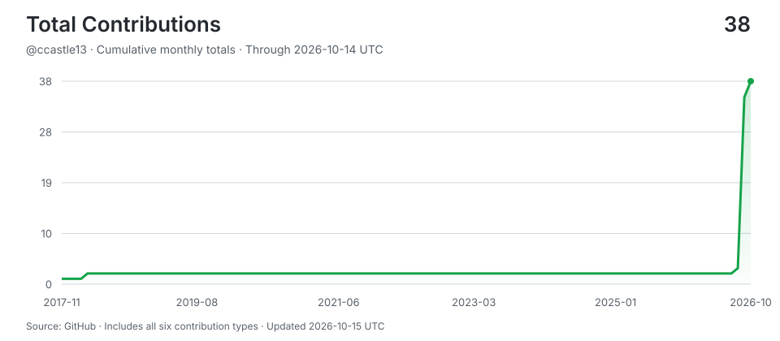

# ccastle13

> Shipping with AI agents around the clock -- human hours for thinking, machine hours for doing.
>
> Stats auto-updated by [aidevops](https://aidevops.sh).

<!-- STATS-START -->
## Work with AI

| Metric | Yesterday | Prior 7 Days | Prior 28 Days | Prior 365 Days |
| --- | ---: | ---: | ---: | ---: |
| Screen time (Linux) | 23.6h | 155.6h | 592.2h | ~7587h* |
| Interactive human attention | 5.7h | 45.2h | 194.2h | 434.6h |
| Interactive AI generation | 4.3h | 38.8h | 236.4h | 615.4h |
| Worker-classified human attention | 0.0h | 0.0h | 0.1h | 0.1h |
| Worker/headless AI generation | 1.2h | 6.3h | 56.8h | 108.2h |
| Additive observed work | 11.2h | 90.3h | 487.4h | 1,158.3h |
| Interactive sessions | 18 | 34 | 93 | 164 |
| Worker sessions | 71 | 308 | 958 | 1,670 |

_Screen time from linux-systemd-logind:session-lid-lock-state; collection status: ok. *365-day estimate uses observed calendar coverage._

_Periods are completed local calendar days ending at midnight; today is excluded._

_Human attention is unioned wall-clock time, so overlapping sessions are not double-counted. AI generation is additive machine work across sessions; it is not wall-clock concurrency._

_AI session 365-day totals cover 72 days of local assistant session history (not extrapolated)._

## AI Model Usage (last 30 days)

| Model | Requests | Input | Output | Cache read | Cache write | Cache Hit-Rate % | Session Count | Session Hours |
| --- | ---: | ---: | ---: | ---: | ---: | ---: | ---: | ---: |
| gpt-5.6-sol | 20,069 | 111.0M | 5.1M | 2,492.6M | 0 | 95.7% | 267 | 134.0h |
| grok-4.5 | 19,808 | 213.6M | 10.8M | 2,333.6M | 0 | 91.6% | 709 | 130.4h |
| grok-4.6 | 4,886 | 46.1M | 1.9M | 525.5M | 0 | 91.9% | 52 | 28.5h |
| grok-build-0.1 | 2,430 | 5.2M | 346K | 356.6M | 0 | 98.6% | 2 | 8.6h |
| gpt-6-sol | 1,212 | 6.0M | 310K | 221.6M | 0 | 97.3% | 10 | 8.6h |
| grok-4.7 | 700 | 4.4M | 168K | 77.8M | 0 | 94.6% | 6 | 2.3h |
| deepseek-v4-flash | 683 | 3.1M | 173K | 40.4M | 0 | 92.7% | 35 | 1.1h |
| deepseek-v4-pro | 682 | 2.1M | 171K | 95.6M | 0 | 97.8% | 6 | 3.0h |
| grok-4.3 | 148 | 2.7M | 42K | 18.1M | 0 | 86.9% | 9 | 0.4h |
| deepseek-flash | 69 | 526K | 22K | 9.9M | 0 | 95.0% | 3 | 0.2h |
| qwen3-14b-q4-k-m | 4 | 12K | 2K | 38K | 0 | 75.5% | 2 | 1.4h |
| qwen2.5-vl-3b-q4-k-m | 1 | 0 | 0 | 0 | 0 | 0.0% | 1 | 0.0h |
| **Total** | **50,692** | **395.1M** | **19.1M** | **6,172.2M** | **0** | **94%** | **1,039** | **318.4h** |

_6,586.5M total tokens processed. 94% cache hit rate._

## AI Model Usage (all time)

| Model | Requests | Input | Output | Cache read | Cache write | Cache Hit-Rate % | Session Count | Session Hours |
| --- | ---: | ---: | ---: | ---: | ---: | ---: | ---: | ---: |
| gpt-5.6-sol | 47,842 | 259.9M | 12.8M | 6,033.5M | 0 | 95.9% | 371 | 386.5h |
| grok-4.5 | 19,808 | 213.6M | 10.8M | 2,333.6M | 0 | 91.6% | 709 | 130.4h |
| grok-4.6 | 6,177 | 64.6M | 2.3M | 700.2M | 0 | 91.5% | 100 | 35.5h |
| claude-sonnet-5 | 5,447 | 10K | 4.6M | 1,661.0M | 94.2M | 94.6% | 16 | 32.2h |
| gpt-6-astra | 4,486 | 17.6M | 1.0M | 892.6M | 0 | 98.1% | 17 | 30.7h |
| gpt-5.6-terra | 4,485 | 32.8M | 944K | 202.2M | 0 | 86.0% | 389 | 18.1h |
| deepseek-v4-flash | 3,430 | 12.8M | 971K | 329.9M | 0 | 96.2% | 152 | 7.2h |
| grok-build-0.1 | 2,571 | 5.5M | 367K | 367.1M | 0 | 98.5% | 4 | 8.8h |
| gpt-6-sol | 1,212 | 6.0M | 310K | 221.6M | 0 | 97.3% | 10 | 8.6h |
| claude-sonnet-4-6 | 741 | 37 | 60K | 5.9M | 1.3M | 82.1% | 4 | 1.5h |
| grok-4.7 | 700 | 4.4M | 168K | 77.8M | 0 | 94.6% | 6 | 2.3h |
| deepseek-v4-pro | 682 | 2.1M | 171K | 95.6M | 0 | 97.8% | 6 | 3.0h |
| gpt-5.6-luna | 503 | 4.7M | 177K | 37.1M | 0 | 88.6% | 81 | 7.3h |
| grok-4.3 | 173 | 4.1M | 47K | 20.9M | 0 | 83.6% | 14 | 0.5h |
| big-pickle | 155 | 853K | 188K | 11.9M | 0 | 93.3% | 4 | 1.5h |
| deepseek-flash | 69 | 526K | 22K | 9.9M | 0 | 95.0% | 3 | 0.2h |
| gpt-6-astra-fast | 8 | 301K | 1K | 994K | 0 | 76.7% | 1 | 0.1h |
| qwen3-14b-q4-k-m | 4 | 12K | 2K | 38K | 0 | 75.5% | 2 | 1.4h |
| gpt-5.6-sol-pro | 2 | 0 | 0 | 0 | 0 | 0.0% | 1 | 0.0h |
| gpt-5.6-terra-fast | 2 | 0 | 0 | 0 | 0 | 0.0% | 1 | 0.0h |
| nemotron-3-ultra-free | 2 | 57K | 6 | 0 | 0 | 0.0% | 2 | 0.0h |
| nemotron-3.5-lightning-free | 2 | 29K | 3 | 28K | 0 | 49.0% | 2 | 0.0h |
| qwen2.5-vl-3b-q4-k-m | 1 | 0 | 0 | 0 | 0 | 0.0% | 1 | 0.0h |
| **Total** | **98,502** | **630.4M** | **35.1M** | **13,002.8M** | **95.5M** | **94.7%** | **1,777** | **675.7h** |

_13,764.0M total tokens processed. 94.7% cache hit rate._
<!-- STATS-END -->

## Projects

- **[bct2-website](https://github.com/ccastle13/bct2-website)** -- No description
<!-- CONTRIBUTIONS-START -->
## Contributions

- **[aidevops](https://github.com/marcusquinn/aidevops)** -- Vibe-Coding is easy. DevOps is hard. OpenCode & Git token-efficient AI agent automation for your app, business, and personal development. Opinionated tools, services, CLI & API stack for speed, security, and 24/7 results. Open-source first. SOTA everything. Try on your repos for money-making magic.
<!-- CONTRIBUTIONS-END -->

## Connect

---

<!-- UPDATED-START -->
_Stats auto-updated 2026-10-15 21:17 UTC by [aidevops](https://aidevops.sh) pulse._
<!-- UPDATED-END -->

<!-- TOTAL-CONTRIBUTIONS-START -->

  <a href="https://commit-history.com/ccastle13?metric=total" target="_blank" rel="noopener noreferrer">
    <picture>
      <source media="(prefers-color-scheme: dark)" srcset="assets/contributions/total-dark.svg" />
      
    </picture>
  </a>

[Verify on commit-history.com](https://commit-history.com/ccastle13?metric=total) · [Chart data](assets/contributions/total.json)

Includes commits, issues, pull requests, reviews, repositories, and restricted contributions. Refreshed daily through the prior UTC day; commit-history.com may use a different refresh cutoff. GitHub controls link navigation—Ctrl/Cmd-click opens verification in a new tab.
<!-- TOTAL-CONTRIBUTIONS-END -->
