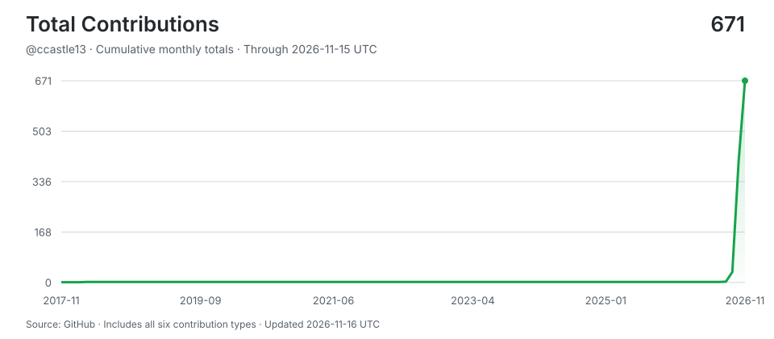

# ccastle13

> Shipping with AI agents around the clock -- human hours for thinking, machine hours for doing.
>
> Stats auto-updated by [aidevops](https://aidevops.sh).

<!-- STATS-START -->
## Work with AI

| Metric | Yesterday | Prior 7 Days | Prior 28 Days | Prior 365 Days |
| --- | ---: | ---: | ---: | ---: |
| Input activity (Linux) | unavailable | unavailable | unavailable | unavailable |
| Interactive human attention | 11.2h | 41.6h | 125.2h | 595.4h |
| Interactive AI generation | 14.3h | 88.8h | 350.8h | 1178.1h |
| Worker-classified human attention | 2.1h | 9.4h | 47.3h | 47.4h |
| Worker/headless AI generation | 50.5h | 186.2h | 380.6h | 495.6h |
| Additive observed work | 77.8h | 323.8h | 895.0h | 2,307.5h |
| Interactive sessions | 23 | 159 | 648 | 971 |
| Worker sessions | 178 | 1,075 | 3,533 | 5,405 |

_Input activity from linux-input-activity; collection status: unavailable (no-input-activity-samples)._

_Periods are completed local calendar days ending at midnight; today is excluded._

_Human attention is unioned wall-clock time, so overlapping sessions are not double-counted. AI generation is additive machine work across sessions; it is not wall-clock concurrency._

_AI session 365-day totals cover 106 days of local assistant session history (not extrapolated)._

## AI Model Usage (last 30 days)

| Model | Requests | Input | Output | Cache read | Cache write | Cache Hit-Rate % | Session Count | Session Hours |
| --- | ---: | ---: | ---: | ---: | ---: | ---: | ---: | ---: |
| grok-4.5 | 35,183 | 220.7M | 18.7M | 3,364.4M | 0 | 93.8% | 923 | 281.1h |
| gpt-5.6-sol | 25,384 | 101.7M | 5.2M | 2,798.8M | 0 | 96.5% | 1,396 | 144.4h |
| claude-opus-5-5 | 12,395 | 25K | 4.8M | 1,982.5M | 56.4M | 97.2% | 225 | 68.3h |
| claude-sonnet-5-5 | 10,455 | 6K | 1.0M | 359.3M | 19.5M | 94.8% | 170 | 34.0h |
| grok-4.6 | 9,779 | 55.5M | 3.2M | 1,102.1M | 0 | 95.2% | 140 | 78.7h |
| MiniMax-M3.1-Flash | 8,596 | 15.1M | 1.8M | 1,239.3M | 0 | 98.8% | 111 | 25.5h |
| claude-haiku-5-5 | 7,868 | 17K | 4.0M | 919.6M | 85.5M | 91.5% | 732 | 64.0h |
| grok-4.7 | 6,192 | 28.7M | 1.1M | 551.5M | 0 | 95.0% | 295 | 31.5h |
| gpt-6.1-sol | 5,450 | 18.1M | 1.3M | 561.2M | 0 | 96.9% | 251 | 26.6h |
| minimax-m3.1-flash-free | 3,200 | 7.6M | 840K | 319.8M | 0 | 97.7% | 54 | 14.9h |
| claude-sonnet-5 | 2,624 | 5K | 977K | 420.0M | 8.9M | 97.9% | 22 | 9.8h |
| qwen3-14b-q4-k-m | 264 | 1.0M | 147K | 5.7M | 0 | 84.5% | 21 | 5.4h |
| MiniMax-M3 | 195 | 377K | 21K | 22.3M | 0 | 98.3% | 5 | 0.6h |
| qwen3-vl-30b-a3b | 192 | 715K | 21K | 7.7M | 0 | 91.5% | 13 | 0.7h |
| claude-haiku-4-5 | 164 | 920 | 24K | 19.0M | 664K | 96.6% | 3 | 0.5h |
| claude-fable-5-2 | 46 | 102 | 15K | 4.2M | 525K | 89.0% | 1 | 0.6h |
| qwen3-8b-q4-k-m | 23 | 18K | 5K | 9K | 0 | 34.3% | 3 | 0.1h |
| qwen3-14b-q4-k-m-nothink | 16 | 87K | 873 | 369K | 0 | 80.8% | 2 | 0.0h |
| deepseek-v4-pro | 7 | 39K | 1K | 142K | 0 | 78.2% | 3 | 0.0h |
| qwen3vl-30b-a3b-q4-k-m | 7 | 49K | 259 | 64K | 0 | 56.5% | 3 | 0.0h |
| qwen3-vl-30b-a3b-q4-k-m | 5 | 0 | 0 | 0 | 0 | 0.0% | 1 | 0.0h |
| claude-opus-4-7 | 3 | 0 | 0 | 0 | 0 | 0.0% | 3 | 0.0h |
| claude-sonnet-4-5 | 2 | 0 | 0 | 0 | 0 | 0.0% | 1 | 0.0h |
| grok-4-5 | 1 | 0 | 0 | 0 | 0 | 0.0% | 1 | 0.0h |
| **Total** | **128,051** | **450.1M** | **43.6M** | **13,678.8M** | **171.6M** | **95.7%** | **4,180** | **786.8h** |

_14,344.3M total tokens processed. 95.7% cache hit rate._

## AI Model Usage (all time)

| Model | Requests | Input | Output | Cache read | Cache write | Cache Hit-Rate % | Session Count | Session Hours |
| --- | ---: | ---: | ---: | ---: | ---: | ---: | ---: | ---: |
| gpt-5.6-sol | 73,226 | 361.6M | 18.1M | 8,832.4M | 0 | 96.1% | 1,766 | 530.9h |
| grok-4.5 | 60,015 | 466.7M | 32.3M | 6,159.1M | 0 | 93.0% | 1,799 | 521.2h |
| grok-4.6 | 16,730 | 129.1M | 5.9M | 1,883.6M | 0 | 93.6% | 242 | 119.4h |
| claude-opus-5-5 | 12,395 | 25K | 4.8M | 1,982.5M | 56.4M | 97.2% | 225 | 68.3h |
| claude-sonnet-5-5 | 10,455 | 6K | 1.0M | 359.3M | 19.5M | 94.8% | 170 | 34.0h |
| MiniMax-M3.1-Flash | 8,596 | 15.1M | 1.8M | 1,239.3M | 0 | 98.8% | 111 | 25.5h |
| grok-4.7 | 8,093 | 37.8M | 1.6M | 765.7M | 0 | 95.3% | 302 | 37.7h |
| claude-sonnet-5 | 8,071 | 16K | 5.6M | 2,081.1M | 103.2M | 95.3% | 38 | 42.0h |
| claude-haiku-5-5 | 7,868 | 17K | 4.0M | 919.6M | 85.5M | 91.5% | 732 | 64.0h |
| gpt-6.1-sol | 5,450 | 18.1M | 1.3M | 561.2M | 0 | 96.9% | 251 | 26.6h |
| gpt-6-astra | 4,486 | 17.6M | 1.0M | 892.6M | 0 | 98.1% | 17 | 30.7h |
| gpt-5.6-terra | 4,485 | 32.8M | 944K | 202.2M | 0 | 86.0% | 389 | 18.1h |
| deepseek-v4-flash | 3,430 | 12.8M | 971K | 329.9M | 0 | 96.2% | 152 | 7.2h |
| minimax-m3.1-flash-free | 3,200 | 7.6M | 840K | 319.8M | 0 | 97.7% | 54 | 14.9h |
| grok-build-0.1 | 2,571 | 5.5M | 367K | 367.1M | 0 | 98.5% | 4 | 8.8h |
| gpt-6-sol | 1,212 | 6.0M | 310K | 221.6M | 0 | 97.3% | 10 | 8.6h |
| claude-sonnet-4-6 | 741 | 37 | 60K | 5.9M | 1.3M | 82.1% | 4 | 1.5h |
| deepseek-v4-pro | 689 | 2.2M | 173K | 95.8M | 0 | 97.7% | 9 | 3.0h |
| gpt-5.6-luna | 503 | 4.7M | 177K | 37.1M | 0 | 88.6% | 81 | 7.3h |
| qwen3-14b-q4-k-m | 268 | 1.0M | 150K | 5.7M | 0 | 84.5% | 23 | 6.8h |
| MiniMax-M3 | 195 | 377K | 21K | 22.3M | 0 | 98.3% | 5 | 0.6h |
| qwen3-vl-30b-a3b | 192 | 715K | 21K | 7.7M | 0 | 91.5% | 13 | 0.7h |
| grok-4.3 | 173 | 4.1M | 47K | 20.9M | 0 | 83.6% | 14 | 0.5h |
| claude-haiku-4-5 | 164 | 920 | 24K | 19.0M | 664K | 96.6% | 3 | 0.5h |
| big-pickle | 155 | 853K | 188K | 11.9M | 0 | 93.3% | 4 | 1.5h |
| deepseek-flash | 69 | 526K | 22K | 9.9M | 0 | 95.0% | 3 | 0.2h |
| claude-fable-5-2 | 46 | 102 | 15K | 4.2M | 525K | 89.0% | 1 | 0.6h |
| qwen3-8b-q4-k-m | 23 | 18K | 5K | 9K | 0 | 34.3% | 3 | 0.1h |
| qwen3-14b-q4-k-m-nothink | 16 | 87K | 873 | 369K | 0 | 80.8% | 2 | 0.0h |
| gpt-6-astra-fast | 8 | 301K | 1K | 994K | 0 | 76.7% | 1 | 0.1h |
| qwen3vl-30b-a3b-q4-k-m | 7 | 49K | 259 | 64K | 0 | 56.5% | 3 | 0.0h |
| qwen3-vl-30b-a3b-q4-k-m | 6 | 0 | 0 | 0 | 0 | 0.0% | 2 | 0.0h |
| claude-opus-4-7 | 3 | 0 | 0 | 0 | 0 | 0.0% | 3 | 0.0h |
| claude-sonnet-4-5 | 2 | 0 | 0 | 0 | 0 | 0.0% | 1 | 0.0h |
| gpt-5.6-sol-pro | 2 | 0 | 0 | 0 | 0 | 0.0% | 1 | 0.0h |
| gpt-5.6-terra-fast | 2 | 0 | 0 | 0 | 0 | 0.0% | 1 | 0.0h |
| nemotron-3-ultra-free | 2 | 57K | 6 | 0 | 0 | 0.0% | 2 | 0.0h |
| nemotron-3.5-lightning-free | 2 | 29K | 3 | 28K | 0 | 49.0% | 2 | 0.0h |
| grok-4-5 | 1 | 0 | 0 | 0 | 0 | 0.0% | 1 | 0.0h |
| qwen2.5-vl-3b-q4-k-m | 1 | 0 | 0 | 0 | 0 | 0.0% | 1 | 0.0h |
| **Total** | **233,553** | **1,126.5M** | **82.1M** | **27,360.2M** | **267.2M** | **95.2%** | **6,117** | **1,581.2h** |

_28,836.1M total tokens processed. 95.2% cache hit rate._
<!-- STATS-END -->

<!-- PROJECTS-START -->
## Projects

- **[bct2-website](https://github.com/ccastle13/bct2-website)** -- No description
<!-- PROJECTS-END -->

<!-- CONTRIBUTIONS-START -->
## Contributions

- **[aidevops](https://github.com/marcusquinn/aidevops)** -- Vibe-Coding is easy. DevOps is hard. OpenCode & Git token-efficient AI agent automation for your app, business, and personal development. Opinionated tools, services, CLI & API stack for speed, security, and 24/7 results. Open-source first. SOTA everything. Try on your repos for money-making magic.
<!-- CONTRIBUTIONS-END -->

## Connect

---

<!-- UPDATED-START -->
_Stats auto-updated 2026-11-18 08:29 UTC by [aidevops](https://aidevops.sh) pulse._
<!-- UPDATED-END -->

<!-- TOTAL-CONTRIBUTIONS-START -->

  <a href="https://commit-history.com/ccastle13?metric=total" target="_blank" rel="noopener noreferrer">
    <picture>
      <source media="(prefers-color-scheme: dark)" srcset="assets/contributions/total-dark.svg" />
      
    </picture>
  </a>

[Verify on commit-history.com](https://commit-history.com/ccastle13?metric=total) · [Chart data](assets/contributions/total.json)

Includes commits, issues, pull requests, reviews, repositories, and restricted contributions. Refreshed daily through the prior UTC day; commit-history.com may use a different refresh cutoff. GitHub controls link navigation—Ctrl/Cmd-click opens verification in a new tab.
<!-- TOTAL-CONTRIBUTIONS-END -->
