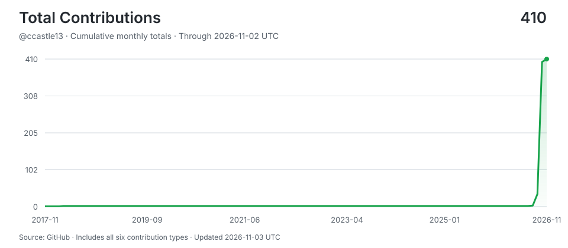

# ccastle13

> Shipping with AI agents around the clock -- human hours for thinking, machine hours for doing.
>
> Stats auto-updated by [aidevops](https://aidevops.sh).

<!-- STATS-START -->
## Work with AI

| Metric | Yesterday | Prior 7 Days | Prior 28 Days | Prior 365 Days |
| --- | ---: | ---: | ---: | ---: |
| Input activity (Linux) | unavailable | unavailable | unavailable | unavailable |
| Interactive human attention | 4.8h | 34.4h | 117.5h | 565.8h |
| Interactive AI generation | 11.9h | 96.3h | 486.5h | 1112.7h |
| Worker-classified human attention | 0.5h | 9.3h | 40.4h | 40.4h |
| Worker/headless AI generation | 13.0h | 58.7h | 218.3h | 327.6h |
| Additive observed work | 30.0h | 195.6h | 854.9h | 2,038.8h |
| Interactive sessions | 19 | 177 | 708 | 851 |
| Worker sessions | 206 | 1,100 | 2,997 | 4,681 |

_Input activity from linux-input-activity; collection status: unavailable (no-input-activity-samples)._

_Periods are completed local calendar days ending at midnight; today is excluded._

_Human attention is unioned wall-clock time, so overlapping sessions are not double-counted. AI generation is additive machine work across sessions; it is not wall-clock concurrency._

_AI session 365-day totals cover 101 days of local assistant session history (not extrapolated)._

## AI Model Usage (last 30 days)

| Model | Requests | Input | Output | Cache read | Cache write | Cache Hit-Rate % | Session Count | Session Hours |
| --- | ---: | ---: | ---: | ---: | ---: | ---: | ---: | ---: |
| grok-4.5 | 38,552 | 241.4M | 20.7M | 3,611.8M | 0 | 93.7% | 1,116 | 377.5h |
| gpt-5.6-sol | 17,972 | 74.4M | 3.9M | 1,864.7M | 0 | 96.2% | 1,248 | 91.4h |
| grok-4.6 | 8,679 | 59.6M | 3.4M | 948.8M | 0 | 94.1% | 107 | 67.5h |
| MiniMax-M3.1-Flash | 8,596 | 15.1M | 1.8M | 1,239.3M | 0 | 98.8% | 111 | 25.5h |
| claude-sonnet-5-5 | 8,040 | 1K | 214K | 64.9M | 1.8M | 97.3% | 48 | 11.0h |
| grok-4.7 | 7,490 | 32.8M | 1.5M | 702.4M | 0 | 95.5% | 255 | 34.8h |
| gpt-6.1-sol | 5,239 | 17.0M | 1.3M | 529.7M | 0 | 96.9% | 251 | 24.9h |
| claude-opus-5-5 | 5,221 | 10K | 2.0M | 828.0M | 23.7M | 97.2% | 120 | 26.6h |
| claude-haiku-5-5 | 3,338 | 7K | 1.5M | 347.9M | 36.2M | 90.6% | 395 | 24.5h |
| minimax-m3.1-flash-free | 3,200 | 7.6M | 840K | 319.8M | 0 | 97.7% | 54 | 14.9h |
| qwen3-14b-q4-k-m | 264 | 1.0M | 147K | 5.7M | 0 | 84.5% | 21 | 5.4h |
| MiniMax-M3 | 195 | 377K | 21K | 22.3M | 0 | 98.3% | 5 | 0.6h |
| claude-haiku-4-5 | 156 | 885 | 23K | 18.7M | 556K | 97.1% | 1 | 0.5h |
| claude-fable-5-2 | 46 | 102 | 15K | 4.2M | 525K | 89.0% | 1 | 0.6h |
| qwen3-14b-q4-k-m-nothink | 16 | 87K | 873 | 369K | 0 | 80.8% | 2 | 0.0h |
| deepseek-v4-pro | 10 | 157K | 2K | 351K | 0 | 69.1% | 4 | 0.0h |
| claude-opus-4-7 | 3 | 0 | 0 | 0 | 0 | 0.0% | 3 | 0.0h |
| claude-sonnet-4-5 | 2 | 0 | 0 | 0 | 0 | 0.0% | 1 | 0.0h |
| grok-4-5 | 1 | 0 | 0 | 0 | 0 | 0.0% | 1 | 0.0h |
| qwen3-vl-30b-a3b-q4-k-m | 1 | 0 | 0 | 0 | 0 | 0.0% | 1 | 0.0h |
| **Total** | **107,021** | **449.8M** | **37.7M** | **10,509.6M** | **62.8M** | **95.3%** | **3,613** | **705.6h** |

_11,060.1M total tokens processed. 95.3% cache hit rate._

## AI Model Usage (all time)

| Model | Requests | Input | Output | Cache read | Cache write | Cache Hit-Rate % | Session Count | Session Hours |
| --- | ---: | ---: | ---: | ---: | ---: | ---: | ---: | ---: |
| gpt-5.6-sol | 65,814 | 334.3M | 16.7M | 7,898.2M | 0 | 95.9% | 1,618 | 477.8h |
| grok-4.5 | 57,825 | 450.4M | 31.3M | 5,915.2M | 0 | 92.9% | 1,762 | 505.4h |
| grok-4.6 | 13,887 | 114.4M | 5.2M | 1,543.9M | 0 | 93.1% | 187 | 96.9h |
| MiniMax-M3.1-Flash | 8,596 | 15.1M | 1.8M | 1,239.3M | 0 | 98.8% | 111 | 25.5h |
| claude-sonnet-5-5 | 8,040 | 1K | 214K | 64.9M | 1.8M | 97.3% | 48 | 11.0h |
| grok-4.7 | 7,497 | 32.9M | 1.5M | 702.6M | 0 | 95.5% | 257 | 34.9h |
| claude-sonnet-5 | 5,447 | 10K | 4.6M | 1,661.0M | 94.2M | 94.6% | 16 | 32.2h |
| gpt-6.1-sol | 5,239 | 17.0M | 1.3M | 529.7M | 0 | 96.9% | 251 | 24.9h |
| claude-opus-5-5 | 5,221 | 10K | 2.0M | 828.0M | 23.7M | 97.2% | 120 | 26.6h |
| gpt-6-astra | 4,486 | 17.6M | 1.0M | 892.6M | 0 | 98.1% | 17 | 30.7h |
| gpt-5.6-terra | 4,485 | 32.8M | 944K | 202.2M | 0 | 86.0% | 389 | 18.1h |
| deepseek-v4-flash | 3,430 | 12.8M | 971K | 329.9M | 0 | 96.2% | 152 | 7.2h |
| claude-haiku-5-5 | 3,338 | 7K | 1.5M | 347.9M | 36.2M | 90.6% | 395 | 24.5h |
| minimax-m3.1-flash-free | 3,200 | 7.6M | 840K | 319.8M | 0 | 97.7% | 54 | 14.9h |
| grok-build-0.1 | 2,571 | 5.5M | 367K | 367.1M | 0 | 98.5% | 4 | 8.8h |
| gpt-6-sol | 1,212 | 6.0M | 310K | 221.6M | 0 | 97.3% | 10 | 8.6h |
| claude-sonnet-4-6 | 741 | 37 | 60K | 5.9M | 1.3M | 82.1% | 4 | 1.5h |
| deepseek-v4-pro | 689 | 2.2M | 173K | 95.8M | 0 | 97.7% | 9 | 3.0h |
| gpt-5.6-luna | 503 | 4.7M | 177K | 37.1M | 0 | 88.6% | 81 | 7.3h |
| qwen3-14b-q4-k-m | 268 | 1.0M | 150K | 5.7M | 0 | 84.5% | 23 | 6.8h |
| MiniMax-M3 | 195 | 377K | 21K | 22.3M | 0 | 98.3% | 5 | 0.6h |
| grok-4.3 | 173 | 4.1M | 47K | 20.9M | 0 | 83.6% | 14 | 0.5h |
| claude-haiku-4-5 | 156 | 885 | 23K | 18.7M | 556K | 97.1% | 1 | 0.5h |
| big-pickle | 155 | 853K | 188K | 11.9M | 0 | 93.3% | 4 | 1.5h |
| deepseek-flash | 69 | 526K | 22K | 9.9M | 0 | 95.0% | 3 | 0.2h |
| claude-fable-5-2 | 46 | 102 | 15K | 4.2M | 525K | 89.0% | 1 | 0.6h |
| qwen3-14b-q4-k-m-nothink | 16 | 87K | 873 | 369K | 0 | 80.8% | 2 | 0.0h |
| gpt-6-astra-fast | 8 | 301K | 1K | 994K | 0 | 76.7% | 1 | 0.1h |
| claude-opus-4-7 | 3 | 0 | 0 | 0 | 0 | 0.0% | 3 | 0.0h |
| claude-sonnet-4-5 | 2 | 0 | 0 | 0 | 0 | 0.0% | 1 | 0.0h |
| gpt-5.6-sol-pro | 2 | 0 | 0 | 0 | 0 | 0.0% | 1 | 0.0h |
| gpt-5.6-terra-fast | 2 | 0 | 0 | 0 | 0 | 0.0% | 1 | 0.0h |
| nemotron-3-ultra-free | 2 | 57K | 6 | 0 | 0 | 0.0% | 2 | 0.0h |
| nemotron-3.5-lightning-free | 2 | 29K | 3 | 28K | 0 | 49.0% | 2 | 0.0h |
| grok-4-5 | 1 | 0 | 0 | 0 | 0 | 0.0% | 1 | 0.0h |
| qwen2.5-vl-3b-q4-k-m | 1 | 0 | 0 | 0 | 0 | 0.0% | 1 | 0.0h |
| qwen3-vl-30b-a3b-q4-k-m | 1 | 0 | 0 | 0 | 0 | 0.0% | 1 | 0.0h |
| **Total** | **203,323** | **1,061.4M** | **71.9M** | **23,299.2M** | **158.4M** | **95%** | **5,309** | **1,370.6h** |

_24,591.0M total tokens processed. 95% cache hit rate._
<!-- STATS-END -->

<!-- PROJECTS-START -->
## Projects

- **[bct2-website](https://github.com/ccastle13/bct2-website)** -- No description
<!-- PROJECTS-END -->

<!-- CONTRIBUTIONS-START -->
## Contributions

- **[aidevops](https://github.com/marcusquinn/aidevops)** -- Vibe-Coding is easy. DevOps is hard. OpenCode & Git token-efficient AI agent automation for your app, business, and personal development. Opinionated tools, services, CLI & API stack for speed, security, and 24/7 results. Open-source first. SOTA everything. Try on your repos for money-making magic.
<!-- CONTRIBUTIONS-END -->

## Connect

---

<!-- UPDATED-START -->
_Stats auto-updated 2026-11-13 18:03 UTC by [aidevops](https://aidevops.sh) pulse._
<!-- UPDATED-END -->

<!-- TOTAL-CONTRIBUTIONS-START -->

  <a href="https://commit-history.com/ccastle13?metric=total" target="_blank" rel="noopener noreferrer">
    <picture>
      <source media="(prefers-color-scheme: dark)" srcset="assets/contributions/total-dark.svg" />
      
    </picture>
  </a>

[Verify on commit-history.com](https://commit-history.com/ccastle13?metric=total) · [Chart data](assets/contributions/total.json)

Includes commits, issues, pull requests, reviews, repositories, and restricted contributions. Refreshed daily through the prior UTC day; commit-history.com may use a different refresh cutoff. GitHub controls link navigation—Ctrl/Cmd-click opens verification in a new tab.
<!-- TOTAL-CONTRIBUTIONS-END -->
